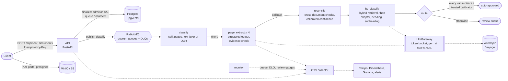

# Manifest

[](https://github.com/DushyantCsharp/Manifest/actions/workflows/ci.yml)
[](https://github.com/DushyantCsharp/Manifest/actions/workflows/eval.yml)

Manifest reads a shipment's document pack: the commercial invoice, the packing list and the bill
of lading. It extracts typed fields and line items, each with the verbatim evidence it was read
from, reconciles them across the three documents, and suggests a 6-digit HS 2022 code for every
line. Then it decides which results it can trust. Shipments whose every value clears a
calibrated confidence threshold are auto-approved; everything else goes to a person, with the
reasons.

**The point is calibrated confidence.** Extraction is table stakes; the product is knowing which
extractions to trust, and measuring that. Every confidence the system prints is a probability
the evals check, and nothing is auto-approved on a number that hasn't been calibrated against a
real model's answers.

## Demo


About a minute of a real run on the local stack: the API, worker, Postgres, RabbitMQ, Redis and
MinIO containers, with the model's answers replayed from recordings, so nothing is billed.

1. **A burst:** 12 shipments, 36 documents, all finalized at once.
2. **Storm shed:** the API admits work up to its high-water mark and answers the rest
   `429 Retry-After`. The client backs off and retries with the same Idempotency-Key.
3. **A storage outage:** MinIO goes down mid-extraction. Workers' storage calls fail, are
   classified as transient, and retry with jittered backoff. Finalizes that need storage fail and
   are retried by the client.
4. **Recovery:** storage comes back and everything completes. Every shipment is routed (some
   auto-approved, the rest to review), with no dead letters.

Re-record it with `make demo` ([`scripts/demo.py`](scripts/demo.py), [`docs/demo.tape`](docs/demo.tape)).

## How it works



- **Upload and admit.** Clients upload straight to object storage through presigned multipart
  URLs, so the API never handles bytes. Finalizing completes the upload, then queues the document
  only if the pending pages are under the high-water mark. That check runs atomically, inside the
  queuing transaction under a lock, so a burst can't slip past it. Above the mark the API answers
  `429 Retry-After`. Every POST is idempotent.
- **Extract each page.** One Celery task per page, fanned out as a chord. The model fills a
  versioned Pydantic schema through structured outputs, copying each value as printed with a
  verbatim evidence span. Code normalises values (Decimal money with ISO 4217 currency, ISO dates,
  Incoterms, kilograms) and checks every span against the page text. No evidence on the page means
  confidence 0.
- **Reconcile and calibrate.** Shipment-level checks compare the three documents: parties,
  totals, weights, line by line. Agreement only ever raises a confidence. Scores go through an
  isotonic calibrator fitted on a real model's answers, versioned and committed.
- **Classify HS codes.** Hybrid retrieval (Postgres full-text plus pgvector, fused with
  reciprocal rank fusion) returns 20 candidate subheadings. The model then walks chapter, heading
  and subheading among them, citing what it relied on, with a calibrated confidence for each step.
- **Route.** A shipment auto-approves only when every value and suggestion clears a trusted
  calibrator's threshold and nothing is open. Otherwise it goes to review, with reasons.
- **Handle failure.** Each stage is a RabbitMQ quorum queue:
  - transient errors retry with jittered backoff;
  - content errors go to review;
  - poison and exhausted messages park in a per-stage DLQ, redrivable with `make dlq`;
  - rate limits re-queue with a countdown and don't spend a retry.

  See [ADR 0001](docs/adr/0001-queue-rabbitmq-quorum-celery.md) and
  [ADR 0003](docs/adr/0003-degradation-policy.md).
- **Observability.** OpenTelemetry end to end:
  - **One trace per document,** from the finalize request through every page task and model
    call to reconcile.
  - **Model calls:** `gen_ai.*` spans with tokens and finish reason. Prompt capture is off by
    default.
  - **Metrics:** throughput, latency, cost by model and stage, queue and DLQ depth, review-queue
    age, and the auto-approve ratio.
  - **Dashboards and alerts:** three Grafana dashboards, and alerts on DLQ growth and stale
    reviews (`infra/`).

## Targets vs measured

<!-- generated:targets -->
_Generated by `make readme` from the eval report (commit `719cde0`, 2026-10-13, profile `model`) and load test `20261013T134003Z` (commit `719cde0`, 2026-10-13)._

**Accuracy and calibration** (evals: real Sonnet 5.5 answers, replayed; `evals/thresholds.yaml`)

| Metric | Target | CI gate | Measured | |
|---|---|---|---|---|
| Field accuracy, all packs | ≥ 96.0% | ≥ 95.0% | 96.7% | met |
| Field accuracy, clean PDFs | ≥ 98.0% | ≥ 98.0% | 99.8% | met |
| Field accuracy, scans (OCR) | ≥ 90.0% | ≥ 87.0% | 89.3% | below target |
| Line-item F1 | ≥ 97.0% | ≥ 95.0% | 96.6% | below target |
| Cross-document mismatches caught | ≥ 95.0% | ≥ 95.0% | 100.0% | met |
| Packs with a false mismatch | ≤ 10.0% | ≤ 45.0% | 37.5% | below target |
| Calibration error (ECE), extraction | ≤ 0.050 | ≤ 0.050 | 0.022 | met |
| Fields auto-approvable at the threshold | ≥ 50.0% | ≥ 50.0% | 93.0% | met |
| Precision of those fields | ≥ 98.0% | ≥ 98.0% | 99.5% | met |
| Auto-approved shipments that were right | ≥ 95.0% | ≥ 95.0% | 100.0% | met |
| Model call per page, p95 | ≤ 30.0 s | ≤ 30.0 s | 11.8 s | met |
| Cost per page | ≤ $0.0500 | ≤ $0.0500 | $0.0165 | met |
| HS: right code among 20 retrieved | ≥ 95.0% | ≥ 92.0% | 94.2% | below target |
| HS accuracy, chapter (2 digits) | ≥ 95.0% | ≥ 93.0% | 95.8% | met |
| HS accuracy, heading (4 digits) | ≥ 85.0% | ≥ 85.0% | 95.0% | met |
| HS accuracy, subheading (6 digits) | ≥ 75.0% | ≥ 75.0% | 92.5% | met |
| Calibration error (ECE), HS | ≤ 0.080 | ≤ 0.100 | 0.070 | met |
| HS walk per line, p95 | ≤ 60.0 s | ≤ 60.0 s | 10.2 s | met |
| Cost per HS line | ≤ $0.0500 | ≤ $0.0500 | $0.0104 | met |

**Throughput, latency, cost** (load test `20261013T134003Z`, HS on, `tools/loadtest/targets.yaml`)

| Metric | Target | Measured | |
|---|---|---|---|
| API p95, every endpoint | ≤ 250 ms | 130 ms | met |
| Pack: first finalize to routed, p50 (at 8 users) | ≤ 30.0 s | 44.4 s | **missed** |
| Pack: first finalize to routed, p95 (at 8 users) | ≤ 60.0 s | 93.9 s | **missed** |
| Page extraction attempt, p95 | ≤ 30.0 s | 13.5 s | met |
| Throughput, one worker host | ≥ 30.0 pages/min | 35.0 pages/min | met |
| API 5xx rate | ≤ 0.0% | 0.0% | met |
| Failed pages | ≤ 0 | 0 | met |
| Packs not routed | ≤ 0 | 0 | met |
| Dead-letter growth | ≤ 0 | 0 | met |
| Cost per page (extraction) | ≤ $0.0300 | $0.0163 | met |
| Cost per pack (everything) | ≤ $0.1000 | $0.0885 | met |
<!-- /generated:targets -->

Regenerate with `make eval`, `make loadtest`, then `make readme`. The eval gates run in CI on
every PR, replaying the committed recordings ([eval.yml](.github/workflows/eval.yml)); live evals
run nightly.

## Eval methodology

### The data

| Set | Size | What it measures |
|---|---|---|
| Clean packs | 25 packs, 75 pages: text-layer PDFs, 5 per invoice layout | Extraction accuracy, false alarms |
| Scanned packs | 15 packs, 45 pages: image-only, read by tesseract, 3 per layout | Accuracy through OCR |
| Mismatch packs | 15 packs, 45 pages: 1-2 injected cross-document mismatches each, all 10 kinds covered | Reconciliation recall |
| HS labels | 120 goods descriptions, each with its HS 2022 subheading | Retrieval recall@20, accuracy at 2, 4 and 6 digits |

- **Splits.** The packs split 28 for calibration and 27 for test, alternating within each
  variant and layout (`evals/splits.json`). The HS labels split 60/60 by chapter, so no code is on
  both sides. Calibrators are fitted on the calibration split; ECE, coverage and precision are
  reported on the test split.
- **Where the labels come from.**
  - **Packs:** the synthetic generator (`evals/src/manifest_evals/synth`, fixed seed) knows what
    it printed, so field and line truth is exact by construction, and mismatch labels are the
    mutations it injected.
  - **HS labels:** written for this corpus and checked against the vendored HS 2022 nomenclature
    (a test asserts every code exists). They are not a customs broker's rulings.
- **Where the answers come from.** Real recordings, made 2026-10-13:
  - Sonnet 5.5 reading every page at effort `low`;
  - Sonnet 5.5 walking every HS line at effort `medium`;
  - voyage-3.5 plus full-text retrieval.

  CI replays them; any stand-in answer drops the gate to a separate "plumbing" profile.
- **Determinism.** Each page's text is snapshotted as the pipeline read it, so a different
  PDFium or tesseract build can't change what's replayed.

### Known biases

- **Synthetic documents.** There are five invoice layouts from one generator, and every
  document is a single page. Real packs are messier: multi-page tables, stamps, handwriting,
  forwarders' own templates. The scans are rendered and degraded synthetically before OCR.
- **Exact labels.** Generator truth measures how faithfully the model copies what's printed, not
  how it handles documents people would disagree about.
- **The HS labels come from one author,** with descriptions cleaner than real invoice text, and
  chapter coverage follows the generator's catalog.
- **Small test splits.** 27 packs (about 2,200 values) and 60 HS lines: one HS line is 1.7
  points, so HS percentages move by several points between runs. Nightly live runs show the
  spread.
- **Calibration is fitted and tested on the same synthetic distribution.** On real traffic the
  calibrators must be refitted before their thresholds mean anything. The worker refuses to
  auto-approve on a calibrator fitted to anything but a real model's answers.
- **One model and one effort level** per stage were recorded, so the numbers hold for that
  configuration.
- **Two failure modes the evals surfaced:**
  - the letterhead layout prints a monogram before the seller's name, and the model copies it;
  - on scans, OCR damage to names (for example "Ertas" for "Ertaş") counts as a cross-document
    mismatch, which drives most false alarms.
- **The load test replays recorded latency on one Docker Desktop VM.** There's no provider-side
  queueing or variance, and the rate limiter is set to 2M tokens a minute.

### How the thresholds were chosen

- **Eval gates** (`evals/thresholds.yaml`): regression floors sit a little under the first real
  recording, leaving room for live-run variance; CI fails below them. The product goals are kept
  as `target`. A metric under its target is reported "below target" without failing, until the
  gate is raised to meet it.
- **The auto-approve threshold** is the lowest calibrated confidence whose precision reaches
  0.99 on the calibration split. Its coverage and precision are then measured on the test split.
- **Load-test targets** (`tools/loadtest/targets.yaml`) size the system for a forwarder handling
  about 5,000 packs a day, peaking at three times the average (30 pages a minute), with the
  model's real latency. They were agreed on 2026-10-13.

## Cost

<!-- generated:cost -->
_Generated by `make readme` from the eval report (commit `719cde0`, 2026-10-13) and load test `20261013T134003Z` (commit `719cde0`, 2026-10-13); prices as of 2026-10-13 (`manifest_llm.pricing`)._

| Unit of work | Model | Input tokens | Output tokens | USD | Measured on |
|---|---|---|---|---|---|
| Page extracted | Sonnet 5.5, effort low | 2,391 | 1,176 | $0.0165 | evals, 165 pages |
| HS line classified (chapter, heading, subheading) | Sonnet 5.5, effort medium | 3,991 | 240 | $0.0104 | evals, 120 lines |
| Shipment pack (3 pages, 3.4 HS lines on average) | both | 22,330 | 4,381 | $0.0885 | load test `20261013T134003Z`, 98 packs |

Price sheet as of 2026-10-13 (USD per million tokens; standard tier, no caching or batch discounts):

| Model | Input | Output |
|---|---|---|
| claude-sonnet-5-5 | $2 | $10 |
| voyage-3.5 | $0.06 | n/a |

Output tokens include the model's thinking. The HS query embedding (voyage-3.5, about ten tokens per line) costs under $0.000001.
<!-- /generated:cost -->

The eval and load-test pipelines count every model call's tokens through the same gateway that
production uses (`cost_usd_total` by model and stage on the Models & cost dashboard).

## What breaks first at 10x

**The HS stage, measured.** `hs_classify` walks a shipment's lines one after another inside a
single task, at about 10 s per line with the real model. Two things follow:

- **Latency.** A pack spends seconds per invoice line in HS even when nothing is queued, so the
  pack-latency targets are missed at any load.
- **Throughput.** HS jobs hold worker processes for 11-46 s each, and extraction waits behind
  them, so one worker host's capacity halves.

<!-- generated:tenx -->
_Generated by `make readme` from the latest load tests with and without HS._

| Load test | Capacity | Pack p50 at 2 users | Worker processes |
|---|---|---|---|
| HS on: `20261013T134003Z` (commit `719cde0`, 2026-10-13) | 35 pages/min | 32.6 s | 8 |
| HS off: `20261013T135415Z` (commit `719cde0`, 2026-10-13) | 72 pages/min | 8.2 s | 8 |

At 10x the design load (300 pages, 100 packs a minute), extrapolated from the HS-on run:

- **Worker processes:** 4.4 pages a minute each, so about 69 processes with the HS stage as it is.
- **Model tokens:** 26,712 per pack, so about 2.7M a minute against the provider's rate limits.
- **Spend:** $0.088 per pack, so about $12,740 a day at list prices.
<!-- /generated:tenx -->

What follows, in order:

1. **Model rate limits** come next. The token rate above is beyond what the load test's
   limiter allows (2M a minute), and beyond most provider tiers without a negotiated limit. The
   token bucket would turn the excess into deferred tasks, so latency grows rather than requests
   failing.
2. **Postgres is unmeasured at that scale.** Admission control counts pending pages on every
   finalize, clients poll shipment status, and the monitor queries the review queue. Each is
   cheap now, but none has been load-tested at 10x.

The fixes, in the order they'd pay off:

1. Walk a shipment's lines in parallel, and give HS its own queue and workers, so it can't
   starve extraction.
2. Cache HS answers by description. The corpus' 139 invoice lines carry only 47 distinct goods
   descriptions, and real catalogs repeat as much.
3. Scale workers horizontally. They are stateless and broker-fed.
4. Raise provider limits, or batch the work that can wait.

## Decisions

- [ADR 0001: RabbitMQ quorum queues with Celery, one queue per stage](docs/adr/0001-queue-rabbitmq-quorum-celery.md)
- [ADR 0002: versioned extraction schemas, expand/contract migrations, out-of-band backfills](docs/adr/0002-schema-migrations-expand-contract.md)
- [ADR 0003: degradation policy: shed early, retry what's transient, route the rest to people](docs/adr/0003-degradation-policy.md)

## Running it

Needs [uv](https://docs.astral.sh/uv/) (Python 3.12) and Docker. Model keys are optional:
evals, the load test and the demo all replay recorded answers.

```sh
make sync                  # dependencies
make check                 # lint, types, unit tests, contract fuzzing, contract drift, evals (no Docker)
make test-integration      # against real Postgres, RabbitMQ, Redis, MinIO (testcontainers)
make up && make migrate    # the local stack: Postgres, RabbitMQ, Redis, MinIO, OTel, Grafana
make app                   # the API (:8010), worker and monitor images against it
make loadtest              # Locust against the images; report in tools/loadtest/reports
make demo                  # re-record docs/demo.gif (vhs)
make readme                # regenerate this README's tables from the latest reports
```

Grafana is on :3000 (the dashboards are in the Manifest folder), Prometheus on :9090, and the
RabbitMQ console on :15672. With `ANTHROPIC_API_KEY` set the worker calls the model for real;
`make eval-record` re-records the eval answers (it costs money). `CLAUDE.md` is the engineering
guide: the rules the code follows, and every `make` target.

| Path | What |
|---|---|
| `services/api`, `services/worker` | FastAPI (REST and GraphQL) and the Celery pipeline |
| `libs/domain` | Schemas, normalisers, evidence checks, reconciliation, scoring, calibration, routing |
| `libs/db`, `libs/llm`, `libs/hs`, `libs/telemetry` | Postgres and migrations; model gateway; HS retrieval and walk; OpenTelemetry |
| `evals` | The corpus, labels, recordings, harness and gates |
| `tools/loadtest`, `scripts/` | The load test and its targets; demo, README and contract scripts |
| `infra` | Compose stack, Grafana dashboards, Prometheus alert rules |
| `docs/adr` | Architecture decisions |
